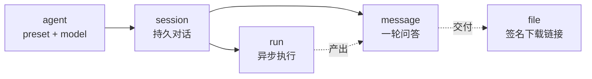
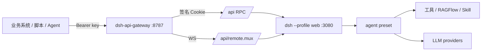
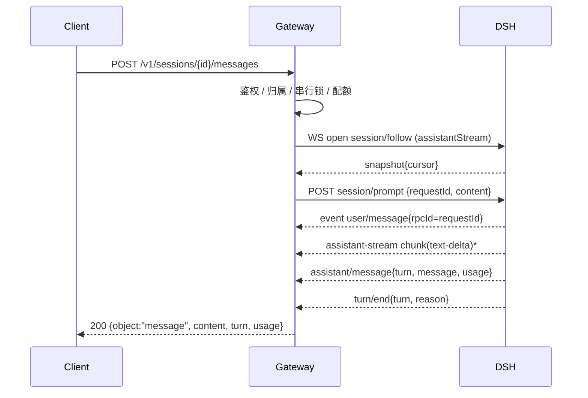

# deepseek-harness-gateway

把 DeepSeek Harness（`dsh`）工作区里**已经配置好的 Agent 能力**开放成一套常规 HTTP API。

不是 Dify 适配层，也不是 OpenAI 兼容层：资源只有 `agent` / `session` / `message` / `run` 四类，
字段扁平、语义直给。任何语言、任何框架按这四类资源调用即可。

每个版本的变更见 [`CHANGELOG.md`](CHANGELOG.md)。

```bash
curl -X POST http://127.0.0.1:8787/v1/sessions \
  -H "Authorization: Bearer $KEY" -H "Content-Type: application/json" \
  -d '{"agent":"assistant"}'
# → {"id":"session-...","agent":"assistant","model":"deepseek-official/deepseek-flash:max",...}

curl -X POST http://127.0.0.1:8787/v1/sessions/session-.../messages \
  -H "Authorization: Bearer $KEY" -H "Content-Type: application/json" \
  -d '{"input":"帮我准备下周的会议预案"}'
# → {"object":"message","content":"...","turn":1,"usage":{...},
#    "files":[{"name":"会议预案.docx","download_url":"/v1/files/eyJ...","size":24813}]}

curl -OJ "http://127.0.0.1:8787/v1/files/eyJ..."
# → 会议预案.docx（链接自带授权，不需要 Bearer）
```

---

## 0. 结论先行

DSH 仓库里的 `docs/api-gateway.zh.md` 讲的是 **Host ↔ Client 之间的内部 Typert RPC 网关**，
不是对外接口。真正可编程的入口是 `dsh --profile web` 暴露的 `/connect` + `/api` + `/api/remote.mux`，
但它面向浏览器：进程级随机令牌、签名 Cookie、单一 owner 身份、内部信封格式。

所以方案是**加一层薄 sidecar**，不改 DSH 一行源码：

```
外部系统 ──Bearer key──▶ dsh-api-gateway ──Cookie / WS──▶ dsh web ──▶ preset ──▶ 工具 / 模型
```

网关只做四件事：**鉴权、资源抽象、事件投影、租户与限额**（外加把产物文件递出去）。
核心约 5000 行（`src/`），零运行时依赖。

### 0.1 两种运行形态

| | 插件形态 | CLI 形态 |
|---|---|---|
| 安装 | `dsh plugin --profile web add deepseek-harness-gateway` | `npm i -g deepseek-harness-gateway` |
| 进程 | 跑在 DSH 宿主进程内 | 独立进程 |
| 连 DSH | 直接调服务（`cordis:in-process`） | `/connect` + `/api` + WS |
| 需要令牌 | 不需要 | `DSH_API_TOKEN` / `DSH_TOKEN_FILE` |
| 对外契约 | **完全相同** | **完全相同** |

`/healthz` 的 `dsh.base_url` 会显示当前形态：`cordis:in-process` 或 `http://127.0.0.1:3080`。

---

## 1. 源码结构与可用入口

### 1.1 四种可编程表面

| 表面 | 位置 | 结论 |
|---|---|---|
| **web `/api` RPC** | `packages/client/connection` + `packages/api/gateway` | ✅ 本方案采用：能力最全，浏览器同源 |
| TypeScript SDK | `packages/sdk` | 只能在 DSH 仓库内用（workspace 包，未发 npm） |
| Python SDK | `python/sdk` | 走 stdio JSON-RPC，起一个 headless agent；并发/租户模型不同 |
| ACP / webhook | `packages/acp`、`packages/webhook` | 面向编辑器集成与出站回调，不适合作通用入站 API |

### 1.2 web 表面已经有什么

- `POST /api/<endpoint>`：一元 RPC，信封 `{type:"client-request", rpcId, method, payload:{args}}`。
- `WS /api/remote.mux`：流，一条 WebSocket 多路复用，`streamId` 区分逻辑流。
- `GET /connect?token=…`：换取签名 Cookie；令牌是**每进程随机**，只打印在 `dsh web:` 那一行 URL 里。

> 消息通道不是 SSE：一元调用走 HTTP，流走 WebSocket。SSE 只在开发态 HMR 里出现。
> 对外则由本网关重新以 SSE 输出（见 4.6）。

### 1.3 为什么不用 SDK profile

`headless` profile 会为每次调用起一个 agent 进程，适合“一次性任务”，不适合“多轮会话 + 并发租户”。
web profile 的 `sessionController` 已经是长期驻留的会话服务，复用它成本最低。

---

## 2. 已配置能力盘点（实测，非推测）

### 2.1 Profile 组成

`~/.dsh/profiles/web`：

```
dsh-base → dsh-web-app → rrb-supervisor-preset → meeting-strategy-preset
```

关键点：**`sessionController` 挂在 `dsh-web-app` 层**，`dsh-base` 里没有。
所以插件装在纯 base profile 上会停在 `pending (waiting for service: sessionController)`。

### 2.2 Agent 预设清单（`agentPresets/list` 实时结果）

本部署 14 个，默认 `rrb-supervisor`：

```
standard  ptc  minimal  cordis
rrb-supervisor (default)      rrb-worker-intake  rrb-worker-research
                              rrb-worker-conflict rrb-worker-report
meeting-strategy              meeting-strategy-intake  meeting-strategy-research
                              meeting-strategy-conflict meeting-strategy-report
```

预设激活失败时 `broken` 字段会带原因（早期本机曾因 `meeting-strategy-tools` 的 isolate 标签不匹配
导致 4 个 `meeting-strategy-*` 全部不可用）。网关不会隐藏这种状态：
`GET /v1/agents` 会返回 `available:false` + `unavailable_reason`，建会话直接 503。

### 2.3 模型路由（`session/modelCatalog` 实时结果）

7 个 provider / 13 个模型，默认 `deepseek-official/deepseek-flash`：

| provider | 模型 |
|---|---|
| `deepseek-official` | `deepseek-flash` `deepseek-v4-pro` |
| `shanheapi` | `deepseek-v4.1-flash` |
| `local` | `deepseek-v4-flash` `qwen3.8-flash-next` |
| `new-api` | `kimi-k2.6` `kimi-k2.7-code` `kimi-k2.8-preview` |
| `requestme` | `deepseek-v4-flash` `deepseek-v4-pro` `deepseek-v4.1-flash` |
| `amd` | `DeepSeek-V4.1-Flash` |
| `aliyuncs` | `deepseek-v4.1-flash-1017` |

### 2.4 工具与技能

- `rrb-supervisor` 体系：RAGFlow 只读检索、需求收集、冲突检查、报告生成，4 个 Worker 子智能体。
- `meeting-strategy` 体系：16 个领域工具 + `rrb-meeting` Skill + Word 报告模板。
- 所有工具都在 Agent 内部调用，**不单独对外暴露**；对外暴露的单位是「agent + 一轮对话」。
  需要观察工具调用细节时用 `stream:"raw"`（4.6.3）。

### 2.5 模型选择的隔离边界（实测）

DSH 里模型选择有两层：

| 层 | 落点 | 作用域 | 何时生效 |
|---|---|---|---|
| 会话级 | `session/selectModel` → 追加 `model/selection` 事件 + 写入 `request/header` | **单个会话，持久** | 本会话后续所有回合 |
| 部署级 | `agentDefaultModel.saveSelection()` → 写 `cordis.patch.yml` | 整个 DSH 进程 | 仅「新建会话的**首轮**」 |

事实（`packages/api/session-controller/src/commands.ts:157-192`、`agent.ts:300-340`）：

1. **会话是隔离的**：A 绑 flash、B 绑 pro，再跑 A 仍是 flash。
2. **未绑定的会话也是粘的**：首轮把 `request/header` 写死后，默认值再变也不影响它。
3. **唯一会漂移的是「新会话首轮」**：`selectModel` 里 `void agentDefaultModel.saveSelection(...)` 是无条件调用；
   `prompt` / `create` 都不接受模型参数，preset 也不带模型，因此没有“只写会话不写默认”的入口。

网关的处理是：**建会话时固定一次，且发生在首轮之前**。`agents[].model` 优先，缺省用 `models.default`：

```json
{
  "models": { "default": { "provider": "deepseek-official", "model": "deepseek-flash", "reasoningEffort": "max" } },
  "agents": [
    { "id": "assistant", "preset": "standard" },
    { "id": "rrb-research", "preset": "rrb-worker-research",
      "model": { "provider": "deepseek-official", "model": "deepseek-flash", "reasoningEffort": "high" } }
  ]
}
```

- `models.default` 留空 → 不固定，新会话首轮继承 DSH 当前默认（会被任何 `selectModel` 改写）。
- 配置后 `/v1/agents`、`POST /v1/sessions` 与消息响应都会回报 `model` 与 `model_source`
  （`agent` / `models.default` / `dsh-default` / `request`）。
- 代价：建会话多一次 RPC（~10ms）；`agentDefaultModel` 被反复写成同一个值（不产生漂移）。
- 残留副作用：DSH Web UI 的模型选择器与网关的 `models.default` 会互相覆盖，谁的 `selectModel` 后发生听谁的。
  **会话内不受影响**。

### 2.6 web 端能力面 vs 网关暴露状态

web 端 71 个 client 包，最终落到 13 个 Remote namespace：

| 能力 | 底层 Remote 面 | 网关状态 |
|---|---|---|
| 对话、多轮、取消 | `session/create` `prompt` `cancel` `follow` | ✅ `POST /sessions`、`POST /sessions/{id}/messages`、`/cancel` |
| 工具调用、步骤、审批、反问、子智能体、计划模式 | 都在 `session/follow` 的事件流里 | ✅ `stream:"raw"`（4.6.3）原样转发 |
| 替人回答 `ask_user_question` | `user-questions/request` 瀑布 + `$events/result` | ✅ `/v1/sessions/{id}/questions`（4.12） |
| 模型目录、预设清单 | `session/modelCatalog` `agentPresets/list` | ✅ `/v1/models`、`/v1/agents` |
| 会话历史、投影 | `session/page` `projections` | ✅ `GET /sessions/{id}/messages` |
| 文件预览 / 工作区文件读 | `workspaceFiles/read` `readBytes` `stat` `list` | ✅ `/v1/sessions/{id}/files`（4.11） |
| 后台长任务 | `session/prompt` + 事件流 | ✅ `/v1/runs`（网关自建异步壳） |
| 会话重命名 / 分叉 / 归档 / 置顶 | `session/rename` `fork`、`workspace/archiveSession` `pinSession` | ⬜ 未开放（见 11 节） |
| 工作区列表 / 创建 | `workspace/create` `follow` | ⬜ 未开放 |
| 技能目录 | `skills/list` | ⬜ 未开放 |
| 后台 shell 任务 | `job/list` `kill` | ⬜ 未开放 |
| 账号与余额 | `account/getState` | ⬜ 未开放（本机为 signed-out，价值低） |
| 会话全文搜索 | `session/search` | ⛔ 本部署不可用：session-query 索引 `openAt: never` |
| 终端、目录选择、文件浏览 | `terminal/*` `directoryPicker/*` | ⛔ 故意不开放：需要浏览器侧交互态与 PTY |
| 设置、凭据、插件市场 | `settings/*` `credentials/*` | ⛔ 故意不开放：属于部署方运维面 |

**判断口径**：`stream:"raw"` 能观测到的，说明数据已经出得来，只是没有专门接口；
标 ⛔ 的是语义上不该由外部系统驱动。

---

## 3. 资源模型

外部调用方不需要知道 preset、工具、RAGFlow。四个资源就够了：

| 资源 | 是什么 | 谁创建 |
|---|---|---|
| `agent` | 一个已配置好的能力（= DSH preset + 模型 + 工作目录） | 部署方在 `config.json` 里声明 |
| `session` | 一次持续对话；绑定 agent 与模型 | 调用方 `POST /v1/sessions` |
| `message` | 会话里的一条消息；发一条即跑一轮 | 调用方 `POST /v1/sessions/{id}/messages` |
| `run` | 同一轮对话的异步句柄 | 调用方 `POST /v1/runs` |
| `file` | 这一轮产出的文件；带一个可直接下载的链接 | Agent 在回合里写出 |



---

## 4. 接口契约

### 4.0 通用约定

- Base URL：`http://127.0.0.1:8787`（默认只听回环）。
- 鉴权：`Authorization: Bearer <secret>`，除 `/healthz` 外全部必需；`/metrics` 需 admin key 或回环。
- 请求体：`application/json`；响应：`application/json` 或 `text/event-stream`。
- 时间戳：Unix 秒（整数）。
- 每个响应带 `x-request-id`，与错误体里的 `request_id` 一致。
- 列表统一 `{"object":"list","data":[...],"has_more":false}`。

### 4.1 `GET /healthz`（免鉴权）

```json
{"status":"ok","version":"0.6.0",
 "dsh":{"reachable":true,"presets":14,"base_url":"cordis:in-process"}}
```

DSH 不可达时返回 `503` + `status:"degraded"`，body 里带 `error`。可直接用作 k8s readiness。

### 4.2 `GET /v1/agents`

```json
{"object":"list","data":[
  {"object":"agent","id":"assistant","name":"通用助手","preset":"standard",
   "model":"deepseek-official/deepseek-flash:max","model_source":"models.default",
   "available":true}
]}
```

| 字段 | 说明 |
|---|---|
| `id` | 调用时用的名字（`config.agents[].id`） |
| `preset` | 对应 DSH 预设 |
| `available` | false 表示该 preset 在当前 profile 激活失败 |
| `unavailable_reason` | 失败原因（截断 300 字） |
| `model_source` | `agent` / `models.default` / `dsh-default`（无固定模型时） |

`available:false` 的 agent 不要调用：建会话会返回 503。

### 4.3 `GET /v1/models`

```json
{"object":"list",
 "data":[{"object":"model","id":"deepseek-official/deepseek-flash","owned_by":"deepseek-official",
          "name":"DeepSeek Flash","context_window":131072,
          "reasoning_efforts":["none","low","medium","high","max"],"is_default":true}],
 "default":{"provider":"deepseek-official","model":"deepseek-flash"}}
```

### 4.4 `POST /v1/sessions`

建会话。**模型在这一步固定**，早于首轮。

```json
{ "agent": "assistant",
  "model": "deepseek-official/deepseek-flash:off",
  "title": "可选，仅网关侧备注" }
```

- `agent` 省略 → 用当前 key 可用的第一个。
- `model` 省略 → 用 `agents[].model` 或 `models.default`；都为空则不固定。
- `model` 支持两种写法：`"provider/model[:effort]"` 或 `{"provider","model","reasoningEffort"}`。

`201 Created`：

```json
{"object":"session","id":"session-c3670f35-...","agent":"assistant",
 "model":"deepseek-official/deepseek-flash:off",
 "title":null,"created_at":1793953137,"last_used_at":1793953137,"running":false}
```

错误：`404 agent_unavailable`（agent 不存在或当前 key 无权）、`503 agent_unavailable`（preset 激活失败）、
`429 session_quota_exceeded`。

### 4.5 `GET /v1/sessions` / `GET /v1/sessions/{id}`

```json
{"object":"list",
 "data":[{"object":"session","id":"session-...","agent":"assistant",
          "model":"deepseek-official/deepseek-flash:max","title":"收到确认指令",
          "created_at":1793953137,"last_used_at":1793953165,"running":false}]}
```

- `?limit=` 默认 50，范围 1–200。
- `title` 来自 DSH 的会话投影（模型自动生成），拿不到时为 `null`。
- `running` 来自 `session/list`；DSH 不可达时降级为 `false`。

### 4.6 `POST /v1/sessions/{id}/messages`

向会话发一条消息，即跑一轮。三种输出模式由 `stream` 决定。

```json
{ "input": "帮我准备下周的会议预案",
  "stream": false,
  "inputs": { "topic": "RRB" },
  "attachments": [{ "type":"image","media_type":"image/png","data":"<base64>" }],
  "timeout_ms": 180000 }
```

| 字段 | 必填 | 说明 |
|---|---|---|
| `input` | 是 | 字符串，或 `[{type:"text",text}]` 数组 |
| `stream` | 否 | `false`（默认）/ `true` / `"raw"` |
| `inputs` | 否 | 仅当 agent 配了 `template` 时可用，渲染 `{{var}}` |
| `attachments` | 否 | 只收 base64 内联图片（png/jpeg/webp/gif），不收远程 URL |
| `timeout_ms` | 否 | 本轮上限，默认 `agents[].maxRunMs` 或 `server.runTimeoutMs` |

#### 4.6.1 `stream:false`（默认）

```json
{"object":"message","id":"msg_85b2a0b0...","session_id":"session-...","role":"assistant",
 "content":"收到","created_at":1793953271,
 "agent":"standard","preset":"standard","model":"deepseek-official/deepseek-flash:max",
 "model_source":"models.default","turn":1,"steps":1,"finish_reason":"stop",
 "usage":{"inputTokens":178,"outputTokens":2,"cacheReadTokens":14848,"totalTokens":15028},
 "elapsed_ms":1140}
```

`finish_reason`：`stop` / `length`（max-tokens）/ `aborted` / `blocked` / `interrupted` / `forked`。

#### 4.6.2 `stream:true`（SSE）

```
data: {"type":"start","session_id":"session-...","message_id":"msg_...","agent":"standard","created_at":1793953271}

data: {"type":"delta","session_id":"session-...","message_id":"msg_...","text":"收到"}

data: {"type":"done","session_id":"session-...","message_id":"msg_...","content":"收到",
       "agent":"standard","turn":1,"finish_reason":"stop","usage":{...},"elapsed_ms":1140}
```

- `delta` 是**增量**，首帧之后拼起来才是全文。
- 出错时发 `{"type":"error","status":502,"code":"provider_error","message":"..."}` 再关闭；
  取消时发 `done` + `finish_reason:"aborted"`。HTTP 头已发出，所以错误只能走事件帧。
- 15 秒一次 `: ping` 注释帧，防中间代理断流。

#### 4.6.3 `stream:"raw"`（原样转发 DSH 会话流）

不做投影、不改写，把 `session/follow` 的帧按到达顺序写成 SSE：

```
snapshot → agent/inbox/spliced → turn/start → step/start → system/message
→ user/message ×5（宿主注入的 agent-instructions / runtime-context / skill-catalog / time-context）
→ request/header → request/context → assistant-stream ×7
→ session/title ×2 → delivery-accepted ×2 → assistant/message → step/end → turn/end
```

工具调用、步骤、审批、反问、子智能体全在这条流里。唯一裁剪是 `seq <= snapshot.cursor` 的历史事件
（它们已经在 `snapshot.records` 里）。超时会补一条 `{"type":"gateway-error","code":"run_timeout"}` 再关闭。

### 4.7 `GET /v1/sessions/{id}/messages`

```json
{"object":"list","data":[
  {"object":"message","id":"seq_12","session_id":"session-...","role":"user",
   "content":"只回复两个字：收到","created_at":1793953138},
  {"object":"message","id":"seq_18","session_id":"session-...","role":"assistant",
   "content":"收到","created_at":1793953139,"turn":1,"step":1}
]}
```

- 只返回真人输入与 assistant 回复；`source.kind !== "user"` 的宿主注入消息被过滤。
- `?limit=` 默认 50，最大 100；返回最近 N 条（`has_more` 目前恒为 `false`）。

### 4.8 `POST /v1/sessions/{id}/cancel`

按会话取消，不必先记住 `message_id`：

```json
{"object":"session","id":"session-...","cancelled":1}
```

`cancelled` 是本次被中止的运行数（同会话并发会被串行锁排队，通常 ≤1）。
正在进行的 `stream:true` 请求会收到 `done{finish_reason:"aborted"}`。

### 4.9 异步运行

**创建** `POST /v1/runs`：

```json
{ "session_id": "session-...", "input": "写一份 3000 字研报" }
```

- 带 `session_id` → 在该会话跑；不带 → 用 `agent`（或默认 agent）新建会话后跑。
- 立即返回 `202`：

```json
{"object":"run","id":"run_084e19a2...","status":"queued",
 "session_id":"session-...","agent":"assistant","created_at":1793953138}
```

**查询** `GET /v1/runs/{id}`：

```json
{"object":"run","id":"run_...","status":"succeeded","session_id":"session-...",
 "agent":"assistant","created_at":1793953138,"started_at":1793953138,"finished_at":1793953142,
 "content":"异步OK","metadata":{"turn":1,"steps":1,"finish_reason":"stop","usage":{...},"elapsed_ms":3810}}
```

`status`：`queued` → `running` → `succeeded` / `failed` / `cancelled`。
失败时给 `error:{code,message}`。

**取消** `POST /v1/runs/{id}/cancel` → `{"object":"run","id":"run_...","status":"cancelling"}`。

> 终态只存在内存，1 小时 TTL、最多 500 条；网关重启后查不到。

### 4.10 `GET /v1/usage` 与 `GET /metrics`

```json
{"object":"usage","key_id":"dev","usage":{"runs":8,"inputTokens":...,"outputTokens":...,"totalTokens":163287},
 "quota":0,"remaining":null}
```

`/metrics` 输出 Prometheus 文本：`dsh_gateway_requests_total`、`dsh_gateway_runs_total`、
`dsh_gateway_run_duration`、`dsh_gateway_tokens_total`、`dsh_gateway_active_runs`、
`dsh_gateway_files_total`、`dsh_gateway_questions_total`。需要 admin key 或从回环地址访问。

### 4.11 文件：产物清单与下载

Agent 答完往往还产出文件。0.5.0 起，**一轮的返回里带 `files`**，每个产物自带签名下载链接：

```json
{"object":"message","content":"会议预案已写好。","files":[
  {"object":"file","name":"会议预案.docx","path":"out/会议预案.docx","source":"present",
   "description":"下周 RRB 会议预案","size":24813,
   "content_type":"application/vnd.openxmlformats-officedocument.wordprocessingml.document",
   "downloadable":true,"download_url":"/v1/files/eyJzIjoi...","expires_at":1794193172}]}
```

| 路由 | 说明 |
|---|---|
| `GET /v1/sessions/{id}/files?path=&limit=` | 浏览会话工作目录（单层） |
| `GET /v1/sessions/{id}/files/{path}` | Bearer 鉴权下载；支持 `?inline=1` 与单段 `Range` |
| `GET /v1/files/{token}` | 签名链接下载，**免 Bearer**，默认 15 分钟内有效 |

三个要点：

1. **产物从事件流里认**，不扫目录：`present` 写下的 `deliverables/presented` 是权威交付声明，
   `write`/`edit` 成功落盘的结果是兜底。同一文件去重，`present` 优先。
2. **范围只能由网关收窄**：DSH 的 `workspaceFiles` 允许读工作区之外的文件，
   所以允许根固定为「会话 cwd + `files.roots`」，并且在 `stat` 拿到 canonical 路径后**再判一次**
   （防符号链接逃逸）。越界的产物会标 `downloadable:false` + `download_error`，不会让整轮变 500。
3. **两种 reader**：宿主 `workspaceFiles`（可跨容器）与本地 `node:fs`（零依赖）；
   `files.reader:"auto"` 只在「上游没有这个能力」时降级，业务错误不降级。

完整规则、安全模型与错误码见 [`docs/files.md`](docs/files.md)。

### 4.12 提问表单：替人回答 `ask_user_question`

模型提问时，调用方可以像填表一样把答案提交回去。0.6.0 起支持（**legacy 形态**）：

| 路由 | 说明 |
|---|---|
| `GET /v1/sessions/{id}/questions` | 当前在等答案的表单 |
| `POST /v1/sessions/{id}/questions/{question_id}/answer` | `{answers:[{id,selected,custom?}]}` 或 `{decline:true}` |

`stream:true` 时 SSE 会多出 `question` / `question_closed` 两种帧；`stream:false` 的调用方
用 `GET /questions` 轮询（会话对象里的 `pending_questions` 可以先探一下）。

```json
// SSE
{"type":"question","question_id":"q_3c4e...","questions":[
  {"id":"q1","question":"选 A 还是 B","header":"确认","options":[{"label":"A"},{"label":"B"}]}],
 "expires_at":1794197322}

// 提交
{"answers":[{"id":"q1","selected":["A"]}]}
```

为什么非做不可：提问走的是**瀑布事件** `user-questions/request`，没人应答时 DSH 不会自己收尾，
那一轮会一直挂着（实测 150 秒无响应）。网关现在订阅 `$events` 承接它——所以
`questions.enabled:false` 也不是「关掉通道」，而是「收到就放行」，保证回合能结束。

legacy 的三个后果：答案只在网关进程内存、没有 `callId` 不能事后补交、超过 `questions.waitMs` 按放行处理。
完整语义、与浏览器界面抢答的竞态、错误码见 [`docs/questions.md`](docs/questions.md)。

---

## 5. 鉴权、租户与限额

### 5.1 API Key

```json
{ "id": "prod", "secret": "至少16位随机串", "agents": ["*"],
  "rpm": 60, "maxConcurrentRuns": 2, "tokenQuota": 0, "admin": false }
```

- 也支持 `secretSha256`（64 位 hex），避免配置里出现明文。
- 校验用 `sha256` + `timingSafeEqual`；错误一律 401，不区分“key 不存在”与“key 错误”。
- `agents` 是白名单，`["*"]` 表示全部。
- `admin:true` 才能读 `/metrics` 与跨 key 访问会话。

### 5.2 租户边界

DSH 只有 owner 身份：同一个 Cookie 能看到并操作所有 session。所以**租户边界只能由网关承担**：

- 建会话时记 `session → keyId`（`data/conversations.json`，0600，原子写）。
- 跨 key 访问与“不存在”返回**同一个 404**，不泄露 session id 是否存在。
- 同一会话一把串行锁：并发发消息会排队，不会两个 turn 交错。

### 5.3 限额

| 配置 | 作用域 | 触发 |
|---|---|---|
| `auth.keys[].rpm` | 每 key 滑动窗口 | 429 `rate_limit_exceeded` |
| `auth.keys[].maxConcurrentRuns` | 每 key | 429 `concurrency_exceeded` |
| `limits.maxConcurrentRuns` | 全局 | 429 `gateway_busy` |
| `auth.keys[].tokenQuota` | 每 key 累计 token | 429 `quota_exceeded` |
| `limits.maxSessionsPerKey` | 每 key 会话数 | 429 `session_quota_exceeded` |
| `server.maxBodyBytes` | 全局 | 413 `body_too_large` |

---

## 6. 错误处理

统一错误体，同时给“给人看”和“给程序判断”的字段：

```json
{"error":{"type":"not_found_error","code":"session_not_found","message":"session session-x 不存在",
          "request_id":"..."},
 "code":"session_not_found","message":"session session-x 不存在","status":404,"request_id":"..."}
```

### 6.1 错误码

| HTTP | code | 场景 |
|---|---|---|
| 400 | `invalid_json` / `invalid_input` / `empty_input` | 请求体问题 |
| 400 | `invalid_model` / `invalid_stream` / `invalid_agent` | 参数格式 |
| 400 | `invalid_path` / `file_not_regular` | 文件路径为空或指向目录 |
| 401 | `unauthenticated` / `invalid_api_key` | 缺少或错误的 Bearer |
| 403 | `forbidden` | 非 admin 读 `/metrics` |
| 403 | `agent_unavailable` | 当前 key 未绑定任何 agent |
| 403 | `file_outside_scope` / `file_not_readable` | 文件越出允许目录 / 无读权限 |
| 403 | `invalid_signature` | 签名下载链接被篡改或过期 |
| 404 | `route_not_found` | 路径不存在 |
| 404 | `session_not_found` / `run_not_found` | 不存在或不属于当前 key |
| 404 | `agent_unavailable` | agent 不存在或无权 |
| 404 | `file_not_found` / `files_disabled` | 文件不存在 / 部署关闭了文件能力 |
| 408 | `run_timeout` | 超过 `timeout_ms` |
| 409 | `approval_required` | 本轮需要人工审批，而部署没有审批通道（见 6.4） |
| 409 | `session_cwd_unknown` | 会话没有工作目录，无法确定文件范围 |
| 413 | `body_too_large` | 超过 `maxBodyBytes` |
| 413 | `file_too_large` | 超过 `files.maxBytes` |
| 416 | `invalid_range` | `Range` 无法满足 |
| 429 | 见 5.3 | 限流/配额 |
| 502 | `provider_error` / `session_create_failed` / `run_incomplete` | DSH 或模型侧失败 |
| 502 | `file_transfer_failed` | 上游给了元数据但没给字节 |
| 503 | `agent_unavailable` | preset 激活失败（`broken`） |
| 503 | `dsh_unreachable` | DSH 不可达 |
| 499 | `client_closed` | 调用方断开（仅日志，不返回体） |

### 6.2 一轮内的失败

- **blocking**：HTTP 非 200 + 错误体。
- **SSE**：HTTP 已是 200，错误只能作为 `{"type":"error",...}` 事件帧发出，然后关闭连接。
- **raw**：同上，额外有一条 `{"type":"gateway-error",...}`。

### 6.4 审批：无人值守部署必须关掉

DSH 默认 `approval.policy = ask`。需要审批的操作会发 `approval/asked`，然后等应答者。
API 调用没有人在场：**实测等 290 秒也没有任何返回**——事件流里根本没有 `approval/decided`。

两层防护：

1. **部署侧（推荐）**：把 profile 的 `approval.policy` 设成 `never`，同时把 `permission.presets` 里的
   `approval` 一并改成 `never`（只改前者会让 `permission-presets` 启动报错）。见 `docs/linux-deploy.md` 第 5 节。
2. **网关侧（兜底）**：看到 `approval/asked` 立刻取消本轮并返回 `409 approval_required`，
   而不是挂到超时。实测 7–8 秒返回，`details` 里带 `tool` 与 `reason`。

```json
{"code":"conflict","status":409,
 "error":{"type":"conflict_error","code":"approval_required",
          "details":{"tool":"write","reason":"escalate sandbox to danger-full-access: …"}}}
```

### 6.3 超时与取消

`timeout_ms` 到期 → 网关向 DSH 发 `session/cancel`，然后：
blocking 返回 408；SSE 发 `error{code:"run_timeout"}`；raw 发 `gateway-error{code:"run_timeout"}`。

调用方主动断开 → 触发 `AbortController` → 同样 cancel 上游，避免模型继续烧 token。

---

## 7. 实现方案

### 7.1 架构



插件形态下 `R`/`M` 换成进程内服务调用（`sessionController.*`），其余不变。

### 7.2 一轮请求的时序（blocking）



三个不能省的细节：

1. **先订阅再提问**：`snapshot.cursor` 是事件分界线，反过来会漏掉 prompt 之后立刻产生的事件。
2. **用 `requestId` 认领回合**：`mode:"queue"` 下若会话里已有 turn 在跑，直接等 `turn/end` 会把**别人的结束**
   当成自己的。只有看到 `user/message.source.rpcId === requestId` 才锁定 `turn`。
3. **`throughSeq` 必须来自 `projections.asOfSeq`**：`session/page` 拒绝超过 cursor 的值
   （实测报 `session page through seq 40 is past cursor 31`）。

### 7.3 代码结构

| 文件 | 职责 | 关键点 |
|---|---|---|
| `src/index.mjs` | 装配、令牌解析、托管 DSH、优雅退出 | `DSH_API_TOKEN` → `DSH_TOKEN` → 配置 → token 文件；轮换后自动生效 |
| `src/plugin.mjs` | 插件入口（`dsh.bundle`） | async `apply`；缺省时按预设展开 agents、生成一次性 key |
| `src/cordis-client.mjs` | 进程内客户端 | 线名 → 服务方法映射；复用 `RemoteStream` 自带队列 |
| `src/config.mjs` | 配置校验 | `loadConfig` 与 `buildConfig` 共用校验；兼容 0.3.x 旧字段 |
| `src/dsh-client.mjs` | `/connect` + `/api` + mux | 每次握手重读令牌；401 自动重握手一次；WS 按 `streamId` 复用 |
| `src/runner.mjs` | 回合编排 | 先订阅后提问、requestId 认领、turn 过滤、模型固定 |
| `src/server.mjs` | 路由、鉴权、限流、SSE、runs | SSE 出错必须发事件帧；`raw` 先订阅后写头 |
| `src/sessions.mjs` | 会话归属 + 串行锁 | 跨 key 与不存在同为 404 |
| `src/usage.mjs` | token 账本与配额 | 预检 + 落盘（0600，原子写） |
| `src/metrics.mjs` | Prometheus 指标 | counter / summary / gauge，无依赖 |
| `src/errors.mjs` | 错误归一 | 结构化 + 扁平双份字段 |

### 7.4 为什么这些决策

| 决策 | 备选 | 理由 |
|---|---|---|
| sidecar / 插件 | fork DSH 加一层 HTTP | fork 要跟随 Typert 生成与构建流水线；外挂可独立发版 |
| 复用 owner Cookie | 新造一套鉴权 | DSH 没有机器凭据体系，owner 是唯一可用身份（代价见 8.1） |
| 四类资源 | 直接铺 13 个 namespace | 调用方不该被 DSH 的内部结构绑架 |
| 先订阅后提问 | 先 prompt 再 follow | 会丢 prompt 后立刻产生的事件 |
| `raw` 原样转发 | 为每种事件写投影 | 工具/审批/子智能体结构复杂，投影必然漏；原样给数据更诚实 |
| 会话归属在网关 | 依赖 DSH 的 remote-access | 它只对“非 owner Peer”生效，而网关就是 owner |

---

## 8. 上游改动点（按必要性）

**P0 已经不需要了**：0.2.0 起支持 `DSH_API_TOKEN` / `DSH_TOKEN_FILE`，令牌轮换不必重启网关。
但要注意：不改 DSH 的前提下，这个值仍须等于 `dsh web` 打印的每进程令牌——
它解决的是「统一入口 + 轮换不重启」，不是「设置一次永久有效」。

| 优先级 | 事项 | 现状 | 落点 |
|---|---|---|---|
| P0 | 稳定机器凭据 | 网关侧兜底 | `browser-auth.ts:61` 的 `processLaunchToken` 支持环境变量 |
| P1 | `/connect` 返回 JSON | 未做 | 现在要解析 302 + Set-Cookie |
| P1 | 稳定增量契约 | 未做 | `assistant-stream` 的 `chunk` 是适配器形状 |
| P1 | `api-key` principal | 未做 | 才能让 DSH 自己承担租户隔离 |
| P2 | multipart 上传 | 未做 | `session-controller` 只收 base64 图片或 `receiptId` |
| P2 | 会话删除 | 未做 | DSH 没有删除接口，会话只增不删 |

---

## 9. 实测记录

同一台机器，DSH `--profile web`：14 个预设 / 13 个模型。

| 场景 | 结果 |
|---|---|
| `GET /healthz` | `presets=14`，`base_url` 正确反映形态 |
| `POST /v1/sessions` | 201，`model` 已固定（含 effort） |
| `POST /messages` blocking | 1659ms，`content="收到"`，usage 完整 |
| 同一 session 续聊 | `turn=2`，历史 4 条 |
| `GET /sessions/{id}` | 标题取自 DSH 投影（`"收到确认指令"`） |
| `stream:true` | 44 个 `delta` 帧，`done` 收尾 |
| `stream:"raw"` | 19 帧，`snapshot → turn/end` 完整 |
| `POST /v1/runs`（带 session） | 202 → 6s 后 `succeeded`，`content="异步OK"` |
| `POST /v1/runs`（自动建会话） | 202，`session_id` 自动生成，内容正确 |
| `POST /sessions/{id}/cancel` | `cancelled:1`，SSE 收到 `done{finish_reason:"aborted"}` |
| 跨 key 读 session | 404（与不存在同码） |
| 未知 agent / 未知 session | 404 |
| 列工作目录 | `path:"."`，文件与子目录都带 `type` |
| 下载 + Range | 200 全文；`Range: bytes=0-4` → 206 `hello` |
| 中文文件名 | `filename*=UTF-8''%E4%B8%AD%E6%96%87.txt`，内容完整 |
| 越界路径 `%2Fetc%2Fpasswd` | 403 `file_outside_scope` |
| 伪造签名链接 | 403 `invalid_signature` |
| 回合产物 | `present` 声明的文件进 `files`，`source:"present"`，`downloadable:true` |
| 签名链接下载 | 不带 Authorization → 200，内容正确 |
| 异步 run 产物 | `GET /v1/runs/{id}` 终态带同一条 `files` |
| 插件形态（进程内） | `base_url: cordis:in-process`，对话 1140ms，流式 53 个 delta |
| 冒烟脚本 | `scripts/smoke.mjs` **28 项全 PASS**（含 `DSH_SMOKE_FILES=1` 的产物链路） |
| 离线单测 | `scripts/test-files.mjs` **54 项全 PASS** |

### 9.1 Linux（Ubuntu 24.04，全新机器，无人值守）

详见 [`docs/linux-deploy.md`](docs/linux-deploy.md)。关键结论：

| 场景 | 结果 |
|---|---|
| `bwrap` + AppArmor 放行 | 根 `ro`、会话 cwd `rw`；写入边界成立 |
| Agent 写 cwd 内 | 成功，无需审批 |
| Agent 写 cwd 外 | `Read-only file system` + `[sandbox: file access denied under workspace-write mode]` |
| 提权（`sandbox_permissions`） | `409 approval_required`，7–8 秒返回（不当配置会挂 290s+） |
| `systemctl restart dsh` | 令牌轮换，网关 ~12 秒自愈，随后对话正常 |
| blocking | 808ms–2.5s（偶发 30–46s 抖动） |
| 冒烟 | 22 项全 PASS |

---

## 10. 部署与运维

> **Linux 服务器部署（无人值守、多租户目录）** 有单独一份实测运行手册：
> [`docs/linux-deploy.md`](docs/linux-deploy.md)。已在全新 Ubuntu 24.04 上跑通，
> 包含 bwrap/AppArmor 前提、systemd 单元、权限策略、写入边界与重启自愈的验证方法。
> 同一次验证的完整记录见 [`docs/test-report-linux-2026-11-06.md`](docs/test-report-linux-2026-11-06.md)（33 项用例 / 5 个缺陷）。
>
> **Docker 部署**见 [`docs/docker.md`](docs/docker.md)：两种镜像（网关独占 331 MB / 一体化 1.48 GB），
> 含容器内沙箱权限矩阵与实测结果。构建：`docker build -f docker/Dockerfile.allinone -t dsh-allinone:0.5.0 .`

### 10.1 作为 DSH 插件安装（单机形态，推荐）

```bash
dsh plugin --profile web add deepseek-harness-gateway
# 重启 DSH（bundle 在启动时装载）
```

启动日志会打印：

```
[dsh-api-gateway] 已启动，监听 127.0.0.1:8787
[dsh-api-gateway] 未配置 auth.keys，本次启动的一次性 API key：xxxxxxxx
```

一次性 key 重启即变，只能用来验证。要给业务方用，在 `~/.dsh/profiles/web/cordis.patch.yml` 加一行覆盖：

```yaml
- id: dsh-api-gateway
  config:
    auth:
      keys:
        - { id: prod, secret: 换成至少16位随机串, agents: ['*'], admin: true }
```

> `agents` / `auth.keys` 不配也能跑：插件激活时会按宿主已注册的预设自动展开，并生成一次性 key。
> 显式配置的优先级更高。

**依赖**：`sessionController` 在 `@deepseek-ai/dsh-web-app` 层。装在纯 base profile 上会停在
`pending (waiting for service: sessionController)`——用 `--profile web`，或把 `dsh-web-app` 加进 `bundles`。

### 10.2 独立进程（CLI 形态）

```bash
npm i -g deepseek-harness-gateway

# 1) 单独跑 DSH
dsh --profile web --no-open --port 3080
#    从输出复制 token：dsh web: http://127.0.0.1:3080/?token=xxxx

# 2A) token 放环境
DSH_BASE_URL=http://127.0.0.1:3080 DSH_API_TOKEN=xxxx \
DSH_GATEWAY_API_KEYS='demo:your-strong-secret' dsh-gateway

# 2B) token 放文件（推荐生产，可轮换）
printf '%s' 'xxxx' > /var/lib/dsh-token
DSH_BASE_URL=http://127.0.0.1:3080 DSH_TOKEN_FILE=/var/lib/dsh-token \
DSH_GATEWAY_API_KEYS='demo:your-strong-secret' dsh-gateway
```

纯环境变量启动不需要 `config.json`；配 `DSH_GATEWAY_AGENTS` 传 agent 定义：

```bash
DSH_GATEWAY_AGENTS='[{"id":"assistant","preset":"standard"}]' \
DSH_GATEWAY_DEFAULT_MODEL='deepseek-official/deepseek-flash:max' \
DSH_GATEWAY_API_KEYS='demo:your-strong-secret' \
DSH_BASE_URL=http://127.0.0.1:3080 DSH_API_TOKEN=xxxx dsh-gateway
```

### 10.3 配置项

| 字段 | 默认 | 说明 |
|---|---|---|
| `server.port` / `host` | 8787 / 127.0.0.1 | 监听 |
| `server.runTimeoutMs` | 300000 | 单轮上限 |
| `server.heartbeatMs` | 15000 | SSE 心跳 |
| `server.maxBodyBytes` | 16 MiB | 请求体 |
| `dsh.baseUrl` / `token` / `tokenFile` | — | CLI 形态 |
| `dsh.spawn` | — | 由网关拉起 `dsh web` |
| `models.default` | — | 部署级兜底模型 |
| `agents[].id` / `preset` | — | 对外名字 / DSH 预设 |
| `agents[].model` | — | `{provider, model, reasoningEffort}` |
| `agents[].template` | — | `{{var}}` 模板，配合请求里的 `inputs` |
| `agents[].maxRunMs` | — | 该 agent 的单轮上限 |
| `auth.keys[].rpm` | 0 | 0 = 不限 |
| `limits.maxConcurrentRuns` | 8 | 全局并发 |
| `limits.maxSessionsPerKey` | 200 | 每 key 会话数 |
| `files.enabled` | true | 关掉后文件路由返回 404 `files_disabled` |
| `files.reader` | `auto` | `auto` / `dsh` / `local` |
| `questions.enabled` | true | false = 收到提问直接放行（仍订阅事件流，避免回合悬挂） |
| `questions.waitMs` | 120000 | 表单等待上限，最大 3600000 |
| `files.roots` | `[]` | 除会话 cwd 外额外允许的绝对目录（拒绝整盘） |
| `files.maxBytes` | 32 MiB | 单文件下载上限 |
| `files.tokenTtlMs` | 15 min | 签名链接有效期 |
| `files.includeWritten` | true | 是否把 `write`/`edit` 产物也算进来 |
| `files.publicBaseUrl` | — | 反代域名，用于拼绝对 `download_url` |
| `files.signingSecret` | 每进程随机 | 多实例部署必须显式配置 |
| `storage.conversationsFile` | `data/conversations.json` | 归属档案 |

环境变量：`DSH_BASE_URL`、`DSH_API_TOKEN`、`DSH_TOKEN`、`DSH_TOKEN_FILE`、`PORT`、`HOST`、
`DSH_GATEWAY_CONFIG`、`DSH_GATEWAY_API_KEYS`、`DSH_GATEWAY_AGENTS`、`DSH_GATEWAY_DEFAULT_MODEL`、
`DSH_GATEWAY_FILES_ENABLED`、`DSH_GATEWAY_FILES_ROOTS`、`DSH_GATEWAY_PUBLIC_BASE_URL`。

> 从 0.3.x 升级：`apps` / `inputTemplate` / `auth.keys[].apps` / `DSH_GATEWAY_APPS` 仍被接受并自动迁移，
> 但新配置请统一用 `agents` / `template` / `auth.keys[].agents` / `DSH_GATEWAY_AGENTS`。

### 10.4 网络与日志

- 默认只监听 `127.0.0.1`。要对外，前面加 nginx 并配 TLS + IP 白名单，不要把 8787 直接暴露。
- 插件形态下网关持有宿主服务引用，**等价于 root 权限**，API key 是唯一门禁。
- 访问日志一行一条 JSON：`{request_id, method, path, status, ms}`；`server.accessLog:false` 可关。
- `data/` 下是归属与用量档案（0600）。`data/dsh-token` 若存在请自行限制权限。

---

## 11. 已知限制与路线图

1. **单 owner 身份**：网关持有 owner 凭据（或进程内服务引用），等于拥有 DSH 全部权限。
   不要把同一个实例共享给互不信任的调用方；需要强隔离就一个租户一个 DSH。
2. **推理增量不透传**：只转发 `text-delta`，reasoning 被丢弃（要完整过程用 `stream:"raw"`）。
3. **文件只读**：能列、能下，不能传、不能改、不能删。写文件仍然只能由 Agent 在会话里做。
4. **无文件上传**：只支持 base64 内联图片，不支持远程 URL（避免 SSRF）。
5. **产物只从事件流来**：Agent 用 bash 写、又没 `present` 的文件不会进 `files`（`GET /files` 仍可见）。
6. **单文件上限 32 MiB**（`files.maxBytes` 可调）：超限返回 413，不做分片下载协议。
7. **文件不递归列举**：`GET /files` 一次只列一层，和 DSH 的 `list` 一致。
8. **会话只增不删**：DSH 没有删除接口。
9. **异步 run 结果在内存**：1 小时 TTL，重启丢失（含其中的 `files`）。
10. **模型绑定会写部署默认**：`selectModel` 的既有语义，会话内不受影响（见 2.5）。
11. **`has_more` 恒为 false**：历史一次性取最近 N 条，没有游标分页。
12. **提问只支持 legacy 形态**：答案必须落在 `questions.waitMs` 窗口内，且只在网关进程内存里；
    进程重启即丢失。timed 形态（可事后补答）未实现，见 [`docs/questions.md`](docs/questions.md)。
13. **浏览器会抢答**：同一实例开着浏览器界面时，`user-questions/request` 可能被浏览器接管，
    此时 API 侧的 `GET /questions` 一直为空。要么别同实例开浏览器，要么把它当人工兜底。

**路线图**

| 优先级 | 事项 | 落点 |
|---|---|---|
| P1 | 会话管理（rename / fork / archive / pin） | `cordis-client.mjs` 已留映射，缺路由与归属校验 |
| P1 | 游标分页（`before` / `after`） | `session/page` 已支持 `throughSeq` |
| P2 | 技能目录 `/v1/skills` | `skills/list` |
| P2 | 工作区 `/v1/workspaces` | `workspace/follow` 基线流 |
| P2 | 出站回调（完成推事件） | 参考仓库的 `packages/webhook` |
| P2 | 产物落库（跨重启可查） | 现在 `files` 只在当轮响应与异步记录里 |
| P3 | 文件上传（→ `receiptId`） | 需先定义附件生命周期 |

---

## 附：调用示例

### curl

```bash
KEY=your-strong-secret
BASE=http://127.0.0.1:8787

# 1) 有哪些能力
curl -s $BASE/v1/agents -H "Authorization: Bearer $KEY" | jq '.data[] | {id, available}'

# 2) 建会话
SID=$(curl -s -X POST $BASE/v1/sessions \
  -H "Authorization: Bearer $KEY" -H "Content-Type: application/json" \
  -d '{"agent":"rrb-supervisor"}' | jq -r .id)

# 3) 跑一轮（阻塞）
curl -s -X POST $BASE/v1/sessions/$SID/messages \
  -H "Authorization: Bearer $KEY" -H "Content-Type: application/json" \
  -d '{"input":"帮我准备下周的 RRB 会议预案"}' | jq '{content, turn, usage}'

# 4) 流式
curl -N -X POST $BASE/v1/sessions/$SID/messages \
  -H "Authorization: Bearer $KEY" -H "Content-Type: application/json" \
  -d '{"input":"继续","stream":true}'
```

### JavaScript

```js
const res = await fetch(`${BASE}/v1/sessions/${sid}/messages`, {
  method: 'POST',
  headers: { authorization: `Bearer ${KEY}`, 'content-type': 'application/json' },
  body: JSON.stringify({ input: '你好' }),
})
const { content, usage } = await res.json()
```

### Python

```python
import httpx

with httpx.Client(base_url="http://127.0.0.1:8787",
                  headers={"Authorization": f"Bearer {KEY}"}, timeout=300) as c:
    sid = c.post("/v1/sessions", json={"agent": "assistant"}).json()["id"]
    r = c.post(f"/v1/sessions/{sid}/messages", json={"input": "你好"}).json()
    print(r["content"], r["usage"]["totalTokens"])
```

### 流式（Python，逐字打印）

```python
with c.stream("POST", f"/v1/sessions/{sid}/messages",
              json={"input": "讲讲这周的安排", "stream": True}) as s:
    for line in s.iter_lines():
        if not line.startswith("data: "):
            continue
        evt = json.loads(line[6:])
        if evt["type"] == "delta":
            print(evt["text"], end="", flush=True)
        elif evt["type"] == "done":
            print("\n----", evt["finish_reason"], evt["usage"]["totalTokens"])
```

---

## 附：验证清单（改完代码先跑）

```bash
for f in src/*.mjs scripts/*.mjs; do node --check "$f" || echo "FAIL $f"; done
node scripts/test-files.mjs                       # 文件能力的离线单测（54 项，不需要 DSH）
node scripts/test-questions.mjs                   # 提问表单的离线单测（21 项，不需要 DSH）
node scripts/smoke.mjs http://127.0.0.1:8787 <key> <agentId>
DSH_SMOKE_FILES=1 node scripts/smoke.mjs ...      # 额外验证「回答 + present + 下载」全链路
```

冒烟脚本覆盖：健康检查、401、agents、models、模型来源、建会话、blocking、续聊、历史、
会话详情、会话列表、SSE（start/delta/done）、raw（snapshot→turn/end）、404（session/agent）、
跨 key 隔离、列目录、下载、Range、越界 403、伪造链接 403、异步 runs、产物清单、签名链接、
提问列表、未知问题 409、usage、metrics。
